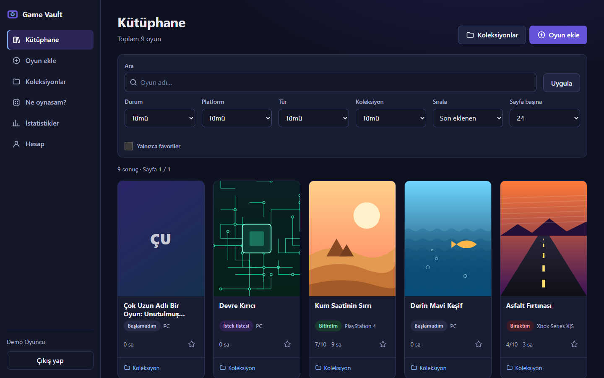
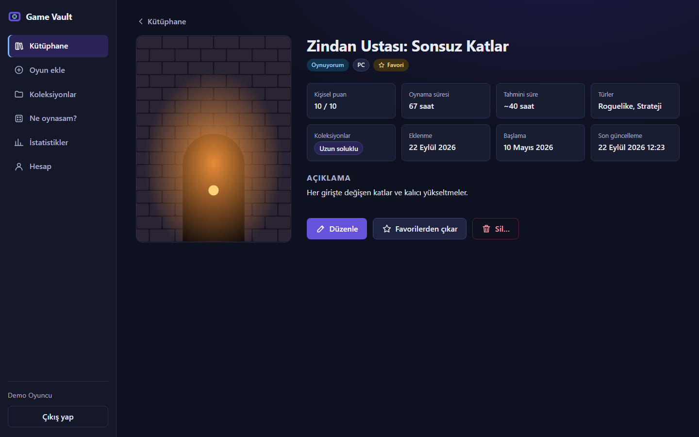
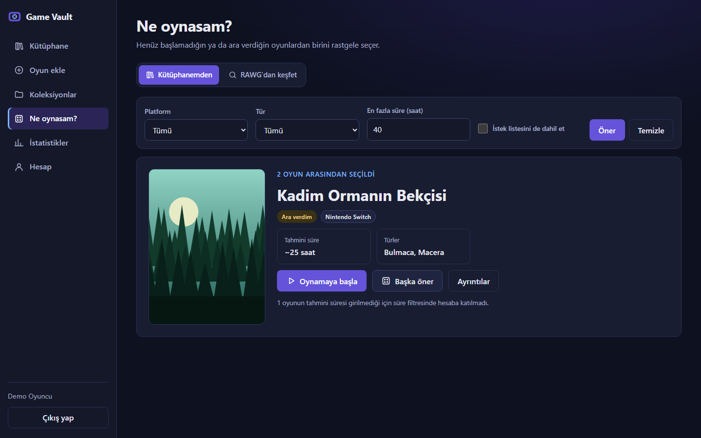
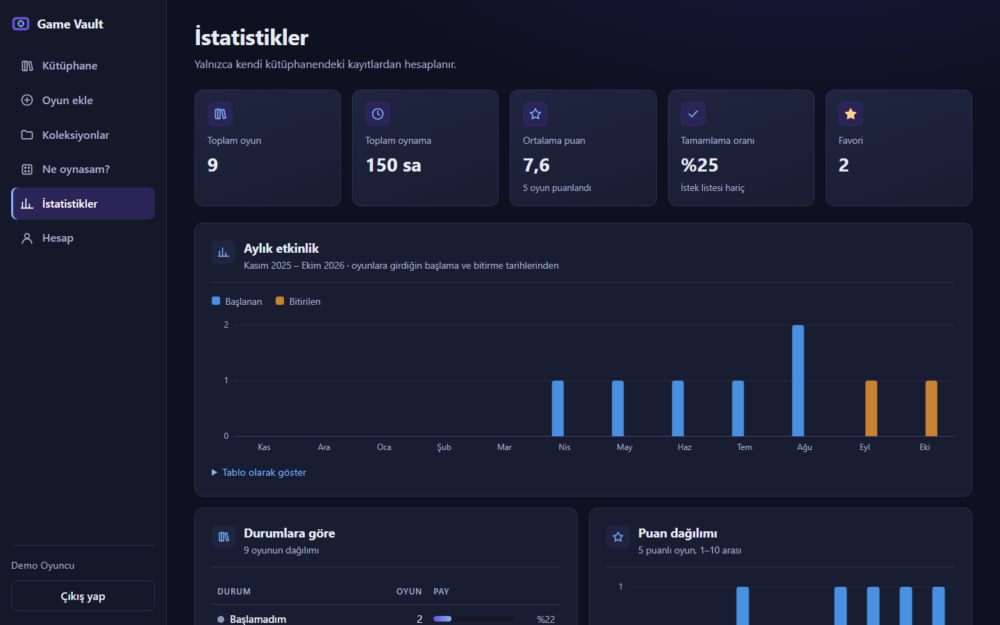
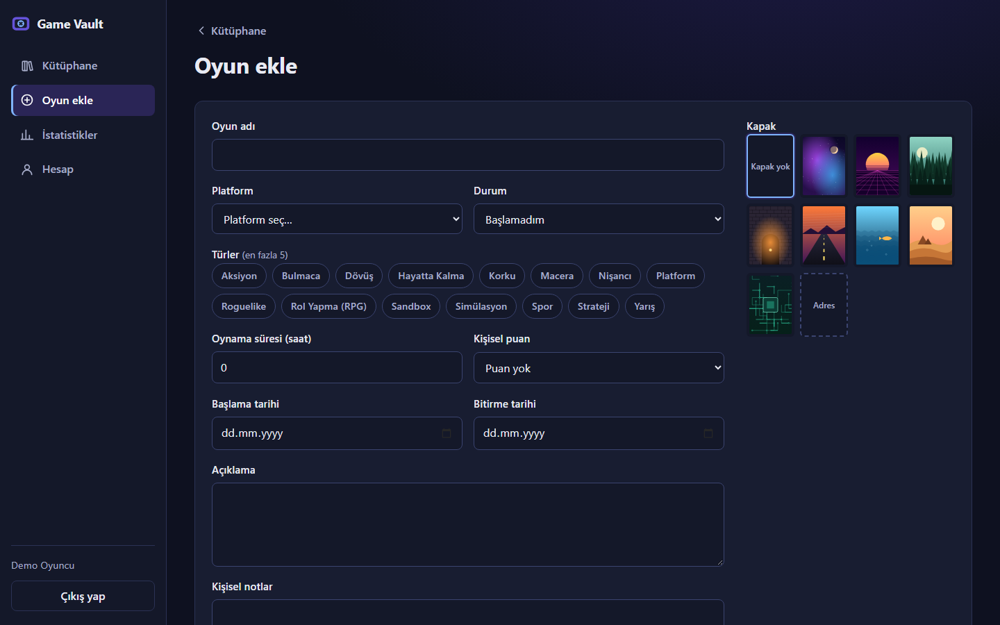
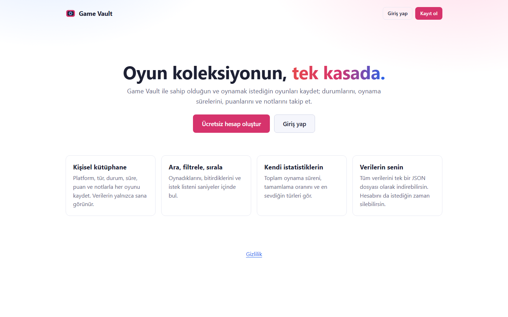
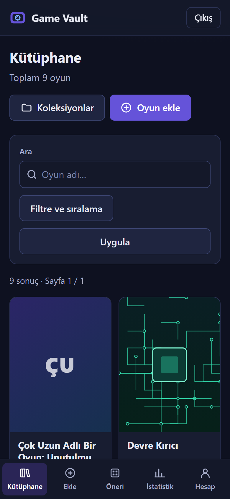
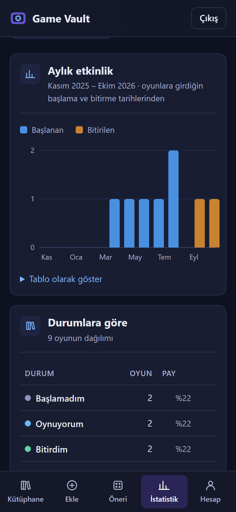
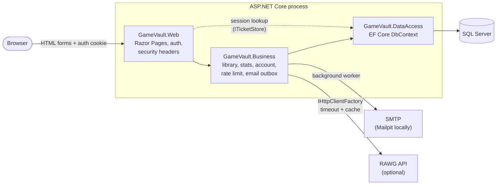
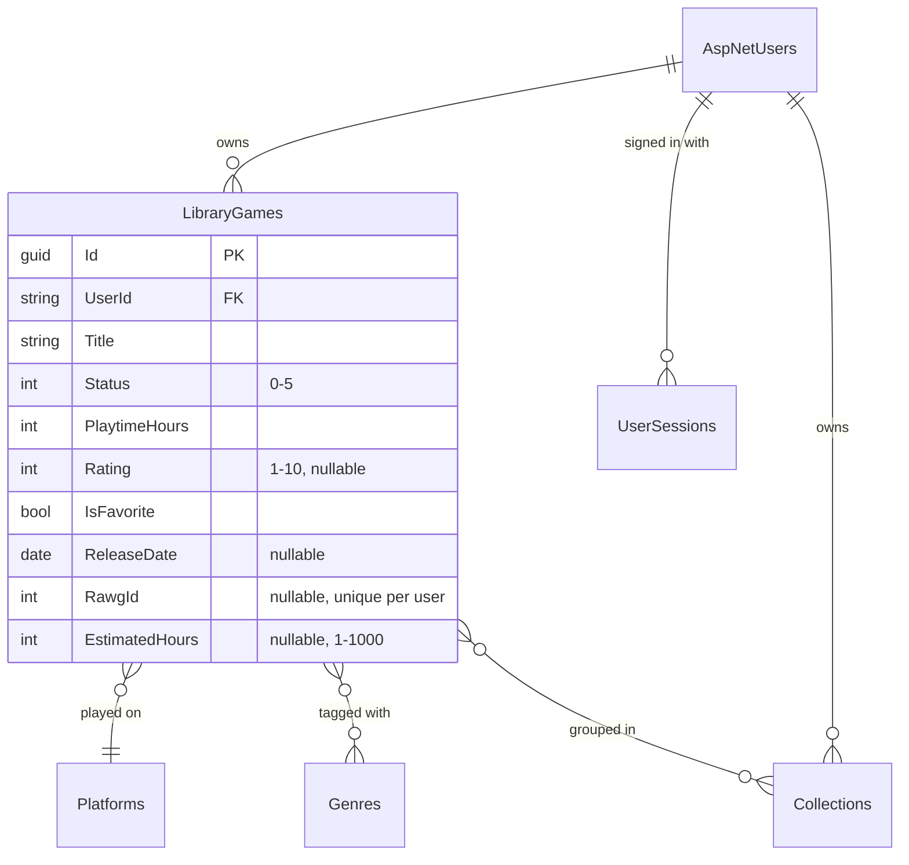

<div align="center">

# 🎮 GameVault

**A personal video game library: track what you play, what you finished and what's next.**

[](https://github.com/MertDas24/GameVault/actions/workflows/ci.yml)


[Türkçe README](README.tr.md)

</div>

GameVault is a server-rendered ASP.NET Core web app where every user keeps a private game library. Users can add
games with covers, platforms and genres, track status, playtime and ratings, filter and search their collection,
see statistics, and export, re-import or delete all of their data. The UI is in Turkish and uses a dark theme.

> This is a **portfolio project**. It runs locally and in CI, but it is not deployed anywhere and it does not
> collect real user data.

## Screenshots

| Library | Game details |
|---|---|
|  |  |
| **What should I play?** | **Statistics** |
|  |  |

<details>
<summary>Add form, landing page and mobile layout</summary>

| Add a game | Landing |
|---|---|
|  |  |
| **Mobile** | |
|  |  |

</details>

The screenshots show fictional demo data. They are generated by a Playwright test
([ReadmeScreenshots.cs](tests/GameVault.E2E/ReadmeScreenshots.cs)), so they can be refreshed with one command:

```powershell
$env:GAMEVAULT_SCREENSHOTS_DIR = "$PWD/docs/screenshots"; dotnet test tests/GameVault.E2E
```

## Highlights

What I focused on, beyond the CRUD:

- **Per-user data isolation.** Every query is scoped to the signed-in user. Integration tests prove that one
  user cannot read, edit, delete or export another user's games, even when they know the game's ID, and that owner fields sent by the client are ignored.
- **Revocable server-side sessions.** The auth cookie only holds a reference to a session row in SQL Server
  (`ITicketStore`). Logout, a password change, a password reset or account deletion invalidates it immediately.
- **Secure by default.** Authorization is required on every page unless the page opts out. The app sends a strict
  Content Security Policy, antiforgery runs on every form and the login responses don't reveal whether an account
  exists.
- **Optional two-factor authentication.** TOTP with a QR code drawn as inline SVG, ten single-use recovery codes and
  replay protection, so a code cannot be used twice. Turning it on, off or regenerating codes asks for the password,
  and turning it on signs out other sessions. Tests generate codes with an independent RFC 6238 implementation.
- **Rate limiting that works across instances.** One atomic SQL `MERGE` counter is shared by all instances, with no
  Redis needed.
- **Reliable email.** Confirmation and password-reset mails go through a database outbox and are retried with
  backoff.
- **Resilient external API.** The RAWG game database is called through `IHttpClientFactory` with a timeout, a
  bounded cache and a simple circuit breaker. When RAWG fails, the page shows a message and the rest of the app keeps
  working. RAWG receives only the search text, or a genre and platform for discovery. The API key lives in User Secrets and never shows up in logs, which a
  test checks.
- **Real tests.** 200+ integration tests run against a real SQL Server through `WebApplicationFactory`. Playwright
  E2E tests cover desktop and mobile flows, and axe-core checks accessibility (WCAG 2.1 A/AA).
- **Strict build.** Warnings are treated as errors, analyzers run at `latest-recommended`, package versions are
  centrally managed and locked, and CI checks that the migrations match the model.

## Features

| Area | What you can do |
|---|---|
| Library | Cover-first cards, search by title, filter by status, platform, genre, collection or favorite, 7 sort orders, pagination. Each card can add the game to or remove it from a collection in one click. |
| Games | Title, cover (8 built-in covers or an allow-listed https URL), description, platform, up to 5 genres, status, playtime, 1–10 rating, notes, start/finish/release dates, estimated hours to beat, favorite, collections. Warns before adding a title that is already in the library. |
| Collections | Personal lists such as "Weekend" or "With friends". Create them on the collections page or by typing a name in the game form; a game can be in up to 10. Renaming or deleting a collection never touches the games. |
| RAWG search | Search [RAWG](https://rawg.io) by title, see cover, release date, platforms and genres, then pick a result to prefill the add form. Each user can add a RAWG game only once. |
| What should I play? | Random pick from the backlog (not started, on hold and optionally wishlist), filtered by platform, genre and max estimated hours. "Pick another" skips the last pick, and "Start playing" marks the game as playing. A discover tab suggests popular RAWG games that are not in the library yet, by the chosen genre or by the genre the user rates highest. |
| Statistics | Summary tiles, then cards for status breakdown, started vs. finished games per month (last 12 months), rating distribution, top platforms and genres, and most played games. Lists are tables with rank, value and share columns. Charts are server-rendered SVG (no chart library, no inline styles), each with a table view. |
| Account | Registration with email confirmation, password reset, display name, password change, sign out other sessions, optional two-factor authentication (authenticator app + recovery codes), JSON export and import (check-first mode, duplicates skipped), account deletion |
| UX | Responsive layout with a sidebar on desktop and a bottom nav on mobile, keyboard accessible, `aria-invalid` form errors, reduced motion support |

Statuses: Not started · Playing · Completed · On hold · Dropped · Wishlist.

## Tech stack

| Layer | Choice |
|---|---|
| Runtime | .NET 10 (LTS), ASP.NET Core Razor Pages (server-side rendering, progressive JS) |
| Data | SQL Server, Entity Framework Core 10, versioned migrations |
| Auth | ASP.NET Core Identity with cookie authentication, server-side session storage and optional TOTP two-factor authentication |
| Email | MailKit (SMTP), Mailpit for local development |
| External API | RAWG Video Games Database via `IHttpClientFactory` (optional) |
| Tests | xUnit v3, WebApplicationFactory, AngleSharp, Playwright (Chromium), axe-core |
| Tooling | Docker, Docker Compose, GitHub Actions, CodeQL, Dependabot, gitleaks |
| Styling | Hand-written, token-based CSS. There is no frontend build step. |

## Architecture

A single ASP.NET Core app (a monolith, on purpose) with a layered solution. Pages call services in the business
layer, the services talk to SQL Server through EF Core, and no layer reaches past the one below it.



```
GameVault.Entities    → EF Core entities (users, library games, genres, platforms, sessions…)
GameVault.DataAccess  → DbContext and migrations
GameVault.Models      → Input models with validation, query normalization, provider-neutral DTOs
GameVault.Business    → Library, statistics, account, rate limiting, email and game catalog (RAWG) services
GameVault.Web         → Razor Pages UI, authentication, security headers, startup validation
tests/GameVault.Tests → Unit and integration tests (real SQL Server)
tests/GameVault.E2E   → Playwright browser tests
```

### Data model



Deleting a user removes their games, collections and sessions. Every library query filters by `UserId`, and the composite
indexes start with `UserId`, so data isolation and query speed rely on the same column. A filtered unique index on
`(UserId, RawgId)` stops the same RAWG game from being added twice, even when two requests race. Collection names are
unique per user (`(UserId, Name)`), and a game can only be linked to its owner's collections.

Design decisions and their reasons are listed in [docs/ARCHITECTURE.md](docs/ARCHITECTURE.md).

### Pages and endpoints

The app has no public JSON API. It is server-rendered, and every write is an HTML form post protected by an
antiforgery token.

| Route | Auth | Purpose |
|---|---|---|
| `/` | anonymous | Landing page |
| `/Account/Register`, `/Account/Login`, `/Account/LoginWith2fa`, `/Account/LoginWithRecoveryCode`, `/Account/ForgotPassword`, `/Account/ResetPassword`, `/Account/ConfirmEmail` | anonymous | Sign-up and sign-in flows (the second step only works after a correct password) |
| `/Library` | user | Search, filter, sort and paginate the user's games (`?q=&status=&platform=&genre=&collection=&fav=&sort=&size=&page=`) |
| `/Library/New`, `/Library/{id}`, `/Library/{id}/Edit`, `/Library/{id}/Delete` | user (owner only) | Create, view, edit and delete a game |
| `/Library/Search?q=` · `/Library/New?rawgId=` | user | Search RAWG, then prefill the add form from a result |
| `/Suggest?platform=&genre=&maxHours=&wishlist=` | user | "What should I play?" suggestion. A POST with `handler=Start` marks the game as playing. `source=rawg` shows the RAWG discover tab. |
| `/Stats` | user | Statistics from the user's own data |
| `/Collections` | user (owner only) | List, create, rename and delete collections |
| `/Account/Settings`, `/Account/TwoFactor`, `/Account/Export`, `/Account/Import`, `/Account/Delete` | user | Profile, password, sessions, two-factor authentication, JSON export and import, account deletion |
| `/health` · `/health/live` | anonymous | Readiness check (database) and liveness check. They return only `Healthy` or `Unhealthy`. |

A request for another user's game returns **404**, not 403, so the app doesn't reveal that the game exists.

## Getting started

### Option A: Windows and LocalDB

Requirements: .NET SDK 10.0.401 or later and SQL Server LocalDB (installed with Visual Studio).

```powershell
dotnet tool restore
dotnet run --project GameVault.Web --launch-profile http
```

Open http://localhost:5226. In Development the `GameVaultDev` database is created and migrated automatically.

New accounts must confirm their email before they can sign in. Run [Mailpit](https://mailpit.axllent.org/) to
receive the local mails at http://localhost:8025. Development refuses to start with a non-local SMTP server, so no
real email is ever sent.

**Optional demo data** (fictional, Development only):

```powershell
dotnet user-secrets set "Seed:DemoPassword" "<at least 10 characters>" --project GameVault.Web
dotnet run --project GameVault.Web -- seed-demo
```

This creates `demo@gamevault.test` with 9 fictional games.

**Optional RAWG search:** get a free key at https://rawg.io/apidocs and store it in User Secrets. The key stays
outside the repository, and you should never put it in `appsettings*.json`.

```powershell
dotnet user-secrets set "Rawg:ApiKey" "<your key>" --project GameVault.Web
```

### Option B: Docker Compose (SQL Server, Mailpit and the app)

```bash
cp .env.example .env        # set your own MSSQL_SA_PASSWORD
docker compose up --build
```

The app runs at http://localhost:8080 and Mailpit at http://localhost:8025.

## Configuration

Local defaults are in [appsettings.Development.json](GameVault.Web/appsettings.Development.json) and contain no
secrets. Override them with `dotnet user-secrets` or environment variables (`:` becomes `__`):

| Variable | Default (Development) | Purpose |
|---|---|---|
| `ConnectionStrings__DefaultConnection` | LocalDB `GameVaultDev` | SQL Server connection string |
| `App__PublicBaseUrl` | `http://localhost:5226` | Base URL used in email links |
| `App__DisplayTimeZone` | `Europe/Istanbul` | Time zone used to display dates (stored as UTC) |
| `Email__Host`, `Email__Port`, `Email__Security` | `localhost`, `1025`, `None` | SMTP server (Mailpit locally) |
| `Email__FromAddress` | `no-reply@gamevault.test` | Sender address |
| `Covers__AllowedHosts__0` | none | Extra host allowed for external cover URLs |
| `Seed__DemoPassword` | none | Password for the optional demo account (user-secrets only) |
| `Rawg__ApiKey` | none | RAWG API key (user-secrets only). Without it, RAWG search is hidden and everything else works. |
| `Rawg__TimeoutSeconds` | `5` | Timeout for a single RAWG request |
| `GAMEVAULT_TEST_SQLSERVER` | LocalDB | SQL Server used by the integration tests (no database name) |

The app validates its configuration at startup and refuses to start with a list of the invalid keys (never their
values). The full production reference is in [docs/OPERATIONS.md](docs/OPERATIONS.md).

## Running the tests

```powershell
dotnet build GameVault.slnx -c Release          # build + analyzers (warnings are errors)
dotnet test tests/GameVault.Tests               # unit + integration (needs LocalDB or GAMEVAULT_TEST_SQLSERVER)
powershell -ExecutionPolicy Bypass -File tests/GameVault.E2E/bin/Debug/net10.0/playwright.ps1 install chromium
dotnet test tests/GameVault.E2E                 # browser tests
```

Each integration test class creates a temporary `GameVaultTest_*` database and drops it afterwards. The test
harness refuses to run against any database without that prefix.

## CI pipeline

GitHub Actions runs on every push to `main` and on every pull request ([ci.yml](.github/workflows/ci.yml)):

| Job | What it checks |
|---|---|
| **Lint, build, test** | `dotnet format`, Release build with warnings as errors, vulnerable NuGet packages, migrations in sync with the model, integration tests against a throwaway SQL Server container (random password), Playwright E2E tests. Uploads test results (TRX) and screenshots. |
| **Docker image build** | Builds the runtime and migrator images and checks the app runs as a non-root user. Checks the production image refuses to start without required config, then starts the full Compose stack and probes `/health`. |
| **Secret scan** | gitleaks (checksum-verified binary) over the full git history |
| **Dependency review** | Blocks pull requests that add vulnerable dependencies |
| **CodeQL** ([codeql.yml](.github/workflows/codeql.yml)) | Static security analysis of the C# code with the `security-extended` queries, plus a weekly scheduled run |

All third-party actions are pinned to full commit SHAs, and workflows default to `contents: read`. Dependabot
keeps NuGet packages, actions and Docker images up to date.

## Documentation

- [docs/ARCHITECTURE.md](docs/ARCHITECTURE.md): architecture and design decisions
- [docs/THREAT_MODEL.md](docs/THREAT_MODEL.md): threat model
- [docs/OPERATIONS.md](docs/OPERATIONS.md): configuration reference and production checklist
- [CONTRIBUTING.md](CONTRIBUTING.md) · [SECURITY.md](SECURITY.md)

The detailed docs are in Turkish.

## License

[MIT](LICENSE). The built-in cover images are original SVGs generated by
[tools/generate-covers.js](tools/generate-covers.js).
