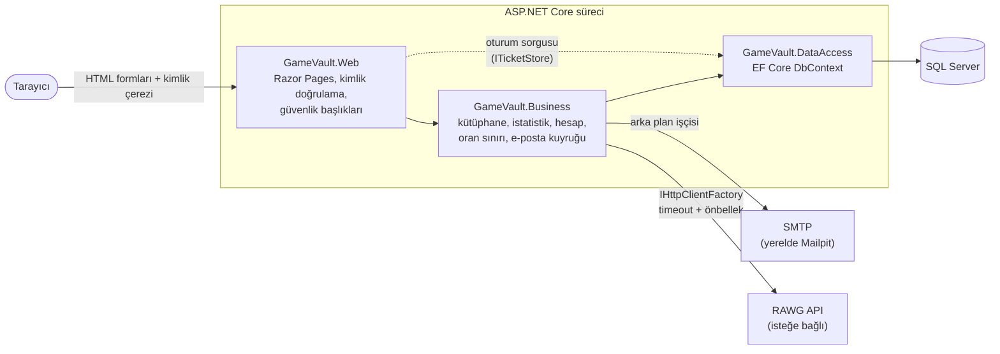
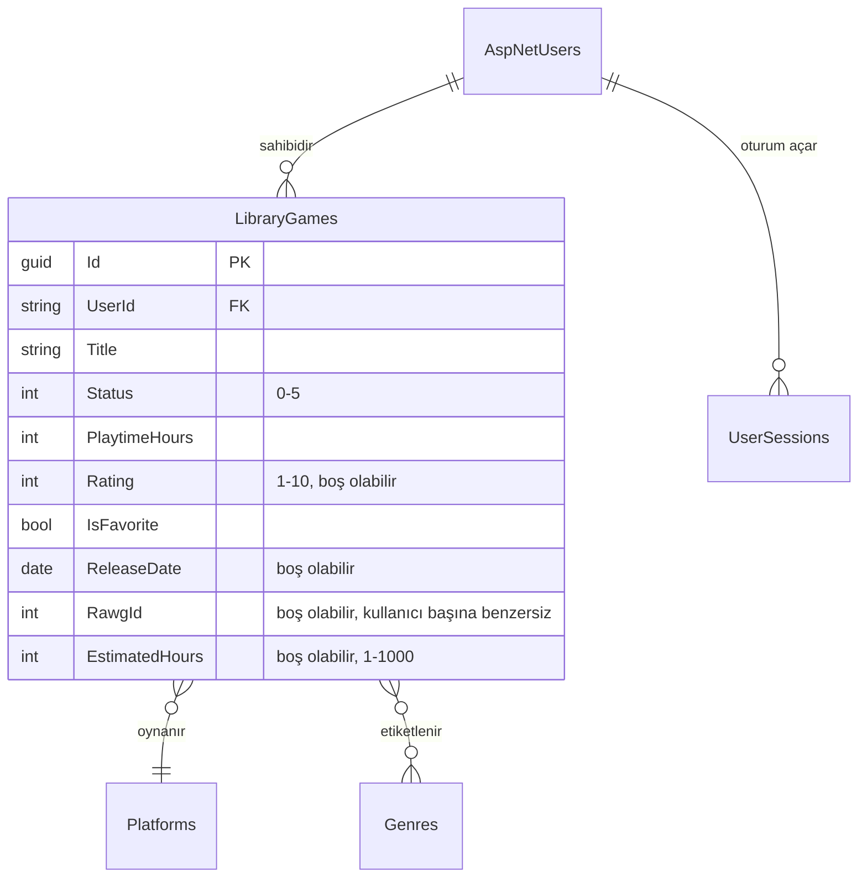

<div align="center">

# 🎮 GameVault

**Kişisel oyun kütüphanesi: ne oynadığını, neyi bitirdiğini ve sırada ne olduğunu takip et.**

[](https://github.com/MertDas24/GameVault/actions/workflows/ci.yml)


[English README](README.md)

</div>

GameVault, her kullanıcının yalnızca kendisinin görebildiği bir oyun kütüphanesi tuttuğu, sunucu tarafında render
edilen bir ASP.NET Core web uygulamasıdır. Kullanıcı kapak, platform ve türleriyle oyun ekler; durum, süre ve puan
takibi yapar; koleksiyonunu arar ve filtreler, istatistiklerini görür, verisinin tamamını dışa aktarabilir, yeniden içe aktarabilir ya da
silebilir. Arayüz Türkçe ve koyu temalıdır.

> Bu bir **portfolyo projesidir**. Yerelde ve CI'da çalışır; hiçbir ortama dağıtılmamıştır ve gerçek kullanıcı
> verisi toplamaz.

## Ekran görüntüleri

| Kütüphane | Oyun ayrıntısı |
|---|---|
|  |  |
| **Ne oynasam?** | **İstatistikler** |
|  |  |

<details>
<summary>Ekleme formu, açılış sayfası ve mobil görünüm</summary>

| Oyun ekleme | Açılış |
|---|---|
|  |  |
| **Mobil** | |
|  |  |

</details>

Görüntülerdeki veriler kurgusaldır. Görüntüleri bir Playwright testi üretir
([ReadmeScreenshots.cs](tests/GameVault.E2E/ReadmeScreenshots.cs)); tek komutla yenilenebilir:

```powershell
$env:GAMEVAULT_SCREENSHOTS_DIR = "$PWD/docs/screenshots"; dotnet test tests/GameVault.E2E
```

## Öne çıkanlar

- **Kullanıcı bazlı veri izolasyonu.** Her sorgu giriş yapan kullanıcıyla sınırlıdır. Entegrasyon testleri, bir
  kullanıcının oyunun kimliğini bilse bile başka bir kullanıcının oyunlarını okuyamadığını, düzenleyemediğini,
  silemediğini ve dışa aktaramadığını, istemcinin gönderdiği sahiplik alanlarının da yok sayıldığını doğrular.
- **İptal edilebilir sunucu tarafı oturumlar.** Kimlik doğrulama çerezi yalnızca SQL Server'daki bir oturum
  kaydına referans tutar (`ITicketStore`). Çıkış, parola değişikliği, parola sıfırlama ya da hesap silme oturumu
  anında geçersiz kılar.
- **Varsayılan olarak güvenli.** Açıkça muaf tutulmayan her sayfa giriş ister. Uygulama katı bir Content Security
  Policy gönderir, her formda antiforgery doğrulaması çalışır ve giriş yanıtları hesabın var olup olmadığını belli
  etmez.
- **Birden fazla instance'ta çalışan oran sınırlama.** Tüm instance'lar tek bir atomik SQL `MERGE` sayacını
  paylaşır, Redis gerekmez.
- **Güvenilir e-posta.** Doğrulama ve parola sıfırlama e-postaları veritabanındaki bir kuyruktan (outbox)
  gönderilir ve hata durumunda artan aralıklarla yeniden denenir.
- **Dayanıklı harici API.** RAWG oyun veritabanı `IHttpClientFactory` üzerinden çağrılır; zaman aşımı, boyutu
  sınırlı bir önbellek ve basit bir devre kesici vardır. RAWG hata verirse sayfa bir mesaj gösterir, uygulamanın geri
  kalanı çalışmaya devam eder. RAWG'a yalnızca arama metni gider. API anahtarı User Secrets'ta durur ve loglara asla
  yazılmaz; bunu bir test doğrular.
- **Gerçek testler.** 200'den fazla entegrasyon testi `WebApplicationFactory` üzerinden gerçek bir SQL Server'a karşı
  çalışır. Playwright E2E testleri masaüstü ve mobil akışları kapsar, axe-core da erişilebilirliği (WCAG 2.1 A/AA)
  denetler.
- **Sıkı derleme.** Uyarılar hata sayılır, analizörler `latest-recommended` seviyesinde çalışır, paket sürümleri
  merkezi olarak yönetilip kilitlenir ve CI migration'ların modelle uyumlu olduğunu kontrol eder.

## Özellikler

| Alan | İçerik |
|---|---|
| Kütüphane | Kapak odaklı kartlar; ada göre arama; durum, platform, tür ve favori filtreleri; 7 sıralama; sayfalama |
| Oyunlar | Ad, kapak (8 hazır kapak ya da izinli https adresi), açıklama, platform, en fazla 5 tür, durum, süre, 1–10 puan, notlar, başlama, bitirme ve çıkış tarihleri, tahmini bitirme süresi, favori. Kütüphanede aynı adlı oyun varsa eklemeden önce uyarır. |
| RAWG araması | [RAWG](https://rawg.io)'da isimle arama; kapak, çıkış tarihi, platform ve türleri görüp bir sonucu seçerek ekleme formunu doldurma. Her kullanıcı bir RAWG oyununu yalnızca bir kez ekleyebilir. |
| Ne oynasam? | Sıradaki oyunlardan (başlanmamış, ara verilmiş, isteğe bağlı olarak istek listesi) platform, tür ve en fazla tahmini süreye göre rastgele öneri. “Başka öner” son öneriyi atlar, “Oynamaya başla” oyunu “Oynuyorum” olarak işaretler. |
| İstatistikler | Toplam oyun ve süre, ortalama puan, tamamlama oranı, durum dağılımı, son 12 ayda aylık başlanan ve bitirilen oyunlar, puan dağılımı, en çok kullanılan platform ve türler, en çok oynananlar. Grafikler sunucuda SVG olarak çizilir (grafik kütüphanesi ve satır içi stil yok); her birinin tablo görünümü vardır. |
| Hesap | E-posta doğrulamalı kayıt, parola sıfırlama, görünen ad, parola değiştirme, diğer oturumları kapatma, JSON dışa ve içe aktarma (önce kontrol modu, kopyalar atlanır), hesap silme |
| Arayüz | Masaüstünde yan menü, mobilde alt gezinme çubuğu; klavyeyle kullanım; `aria-invalid` ile form hataları; azaltılmış hareket desteği |

Durumlar: Başlamadım · Oynuyorum · Bitirdim · Ara verdim · Bıraktım · İstek listesi.

## Teknoloji

| Katman | Seçim |
|---|---|
| Çalışma zamanı | .NET 10 (LTS), ASP.NET Core Razor Pages (sunucu tarafı render, JavaScript yalnızca iyileştirme için) |
| Veri | SQL Server, Entity Framework Core 10, sürümlü migration'lar |
| Kimlik doğrulama | ASP.NET Core Identity, sunucu tarafı oturum saklayan cookie kimlik doğrulaması |
| E-posta | MailKit (SMTP), yerelde Mailpit |
| Harici API | `IHttpClientFactory` ile RAWG Video Games Database (isteğe bağlı) |
| Testler | xUnit v3, WebApplicationFactory, AngleSharp, Playwright (Chromium), axe-core |
| Araçlar | Docker, Docker Compose, GitHub Actions, CodeQL, Dependabot, gitleaks |
| Stil | Elle yazılmış, token tabanlı CSS. Ön yüz derleme adımı yoktur. |

## Mimari

Katmanlı bir çözüme sahip tek bir ASP.NET Core uygulaması (bilinçli olarak monolit). Sayfalar iş katmanındaki
servisleri çağırır, servisler EF Core üzerinden SQL Server'a erişir; hiçbir katman bir alttakini atlamaz.



```
GameVault.Entities    → EF Core varlıkları (kullanıcılar, kütüphane oyunları, türler, platformlar, oturumlar…)
GameVault.DataAccess  → DbContext ve migration'lar
GameVault.Models      → Doğrulamalı girdi modelleri, sorgu normalleştirme, sağlayıcıdan bağımsız DTO'lar
GameVault.Business    → Kütüphane, istatistik, hesap, oran sınırlama, e-posta ve oyun kataloğu (RAWG) servisleri
GameVault.Web         → Razor Pages arayüzü, kimlik doğrulama, güvenlik başlıkları, başlangıç doğrulaması
tests/GameVault.Tests → Birim ve entegrasyon testleri (gerçek SQL Server)
tests/GameVault.E2E   → Playwright tarayıcı testleri
```

### Veri modeli



Bir kullanıcı silindiğinde oyunları ve oturumları da silinir (cascade). Her kütüphane sorgusu `UserId` ile
filtrelenir ve bileşik indeksler `UserId` ile başlar: veri izolasyonu ve sorgu hızı aynı sütuna dayanır. `(UserId, RawgId)` üzerindeki filtreli benzersiz indeks, iki istek
aynı anda gelse bile aynı RAWG oyununun iki kez eklenmesini engeller.

Tasarım kararları ve gerekçeleri: [docs/ARCHITECTURE.md](docs/ARCHITECTURE.md).

### Sayfalar ve endpoint'ler

Uygulamanın herkese açık bir JSON API'si yoktur. Sayfalar sunucuda render edilir; her yazma işlemi antiforgery
tokenı ile korunan bir HTML form gönderimidir.

| Adres | Erişim | Amaç |
|---|---|---|
| `/` | herkese açık | Açılış sayfası |
| `/Account/Register`, `/Account/Login`, `/Account/ForgotPassword`, `/Account/ResetPassword`, `/Account/ConfirmEmail` | herkese açık | Kayıt ve giriş akışları |
| `/Library` | kullanıcı | Oyunları arama, filtreleme, sıralama ve sayfalama (`?q=&status=&platform=&genre=&fav=&sort=&size=&page=`) |
| `/Library/New`, `/Library/{id}`, `/Library/{id}/Edit`, `/Library/{id}/Delete` | kullanıcı (yalnızca sahibi) | Oyun ekleme, görüntüleme, düzenleme ve silme |
| `/Library/Search?q=` · `/Library/New?rawgId=` | kullanıcı | RAWG'da arama ve seçilen sonuçla ekleme formunu doldurma |
| `/Suggest?platform=&genre=&maxHours=&wishlist=` | kullanıcı | “Ne oynasam?” önerisi. `handler=Start` ile yapılan POST, oyunu “Oynuyorum” olarak işaretler. |
| `/Stats` | kullanıcı | Kullanıcının kendi verisinden istatistikler |
| `/Account/Settings`, `/Account/Export`, `/Account/Import`, `/Account/Delete` | kullanıcı | Profil, parola, oturumlar, JSON dışa ve içe aktarma, hesap silme |
| `/health` · `/health/live` | herkese açık | Hazırlık (veritabanı) ve canlılık kontrolü. Yalnızca `Healthy` ya da `Unhealthy` döner. |

Başka bir kullanıcının oyununa yapılan istek 403 değil **404** döner; böylece oyunun var olduğu da belli olmaz.

## Yerelde çalıştırma

### Seçenek A: Windows ve LocalDB

Gereksinimler: .NET SDK 10.0.401 veya daha yenisi, SQL Server LocalDB (Visual Studio ile gelir).

```powershell
dotnet tool restore
dotnet run --project GameVault.Web --launch-profile http
```

http://localhost:5226 adresini açın. Development ortamında `GameVaultDev` veritabanı otomatik oluşturulur ve
migration'lar uygulanır.

Yeni hesaplar giriş yapmadan önce e-postalarını doğrulamalıdır. Yerel e-postaları http://localhost:8025 adresinde
görmek için [Mailpit](https://mailpit.axllent.org/) çalıştırın. Development ortamı yerel olmayan bir SMTP sunucusuyla
başlamayı reddeder; gerçek bir e-posta asla gönderilmez.

**İsteğe bağlı demo verisi** (kurgusal, yalnızca Development):

```powershell
dotnet user-secrets set "Seed:DemoPassword" "<en az 10 karakter>" --project GameVault.Web
dotnet run --project GameVault.Web -- seed-demo
```

Bu komut `demo@gamevault.test` hesabını ve 9 kurgusal oyunu oluşturur.

**İsteğe bağlı RAWG araması:** https://rawg.io/apidocs adresinden ücretsiz bir anahtar alın ve User Secrets'a
kaydedin. Anahtar deponun dışında kalır; `appsettings*.json` dosyalarına asla yazmayın.

```powershell
dotnet user-secrets set "Rawg:ApiKey" "<anahtarınız>" --project GameVault.Web
```

### Seçenek B: Docker Compose (SQL Server, Mailpit ve uygulama)

```bash
cp .env.example .env        # kendi MSSQL_SA_PASSWORD değerinizi girin
docker compose up --build
```

Uygulama http://localhost:8080, Mailpit http://localhost:8025 adresinde çalışır.

## Yapılandırma

Yerel varsayılanlar [appsettings.Development.json](GameVault.Web/appsettings.Development.json) dosyasındadır ve sır
içermez. `dotnet user-secrets` ya da ortam değişkenleriyle değiştirilebilir (`:` yerine `__` yazılır):

| Değişken | Varsayılan (Development) | Amaç |
|---|---|---|
| `ConnectionStrings__DefaultConnection` | LocalDB `GameVaultDev` | SQL Server bağlantı dizesi |
| `App__PublicBaseUrl` | `http://localhost:5226` | E-posta bağlantılarında kullanılan temel adres |
| `App__DisplayTimeZone` | `Europe/Istanbul` | Tarihlerin gösterildiği saat dilimi (UTC saklanır) |
| `Email__Host`, `Email__Port`, `Email__Security` | `localhost`, `1025`, `None` | SMTP sunucusu (yerelde Mailpit) |
| `Email__FromAddress` | `no-reply@gamevault.test` | Gönderen adresi |
| `Covers__AllowedHosts__0` | yok | Harici kapak adresleri için izin verilen ek alan adı |
| `Seed__DemoPassword` | yok | İsteğe bağlı demo hesabının parolası (yalnızca user-secrets) |
| `Rawg__ApiKey` | yok | RAWG API anahtarı (yalnızca user-secrets). Tanımlı değilse RAWG araması gizlenir, geri kalan her şey çalışır. |
| `Rawg__TimeoutSeconds` | `5` | Tek bir RAWG isteğinin zaman aşımı |
| `GAMEVAULT_TEST_SQLSERVER` | LocalDB | Entegrasyon testlerinin kullandığı SQL Server (veritabanı adı olmadan) |

Uygulama başlangıçta yapılandırmasını doğrular; geçersiz anahtarları (değerlerini göstermeden) listeleyip başlamayı
reddeder. Üretim için tam liste: [docs/OPERATIONS.md](docs/OPERATIONS.md).

## Testler

```powershell
dotnet build GameVault.slnx -c Release          # derleme + analizörler (uyarılar hata sayılır)
dotnet test tests/GameVault.Tests               # birim + entegrasyon (LocalDB ya da GAMEVAULT_TEST_SQLSERVER gerekir)
powershell -ExecutionPolicy Bypass -File tests/GameVault.E2E/bin/Debug/net10.0/playwright.ps1 install chromium
dotnet test tests/GameVault.E2E                 # tarayıcı testleri
```

Her entegrasyon test sınıfı geçici bir `GameVaultTest_*` veritabanı oluşturur ve iş bitince siler. Test altyapısı
bu önek dışındaki bir veritabanına karşı çalışmayı reddeder.

## CI hattı

GitHub Actions, `main` dalına yapılan her push'ta ve her pull request'te çalışır ([ci.yml](.github/workflows/ci.yml)):

| İş | Ne kontrol eder |
|---|---|
| **Lint, build, test** | `dotnet format`, uyarıların hata sayıldığı Release derlemesi, zafiyetli NuGet paketleri, migration'ların modelle uyumu, geçici bir SQL Server konteynerine (rastgele parola) karşı entegrasyon testleri, Playwright E2E testleri. Test sonuçlarını (TRX) ve ekran görüntülerini yükler. |
| **Docker image build** | Çalışma zamanı ve migration imajlarını derler, uygulamanın root olmayan kullanıcıyla çalıştığını kontrol eder. Üretim imajının eksik yapılandırmayla başlamayı reddettiğini doğrular, ardından tüm Compose yığınını başlatıp `/health` adresini yoklar. |
| **Secret scan** | Tüm Git geçmişinde gitleaks taraması (sağlama toplamı doğrulanmış ikili dosya) |
| **Dependency review** | Zafiyetli bağımlılık ekleyen pull request'leri engeller |
| **CodeQL** ([codeql.yml](.github/workflows/codeql.yml)) | `security-extended` sorgularıyla C# kodunun statik güvenlik analizi; ayrıca haftalık zamanlanmış çalışma |

Tüm üçüncü taraf action'lar tam commit SHA'larına sabitlenmiştir; iş akışları varsayılan olarak `contents: read`
izniyle çalışır. Dependabot NuGet paketlerini, action'ları ve Docker imajlarını güncel tutar.

## Belgeler

- [docs/ARCHITECTURE.md](docs/ARCHITECTURE.md): mimari ve tasarım kararları
- [docs/THREAT_MODEL.md](docs/THREAT_MODEL.md): tehdit modeli
- [docs/OPERATIONS.md](docs/OPERATIONS.md): yapılandırma başvurusu ve üretim kontrol listesi
- [CONTRIBUTING.md](CONTRIBUTING.md) · [SECURITY.md](SECURITY.md)

## Lisans

[MIT](LICENSE). Hazır kapak görselleri [tools/generate-covers.js](tools/generate-covers.js) ile üretilmiş özgün
SVG'lerdir.
